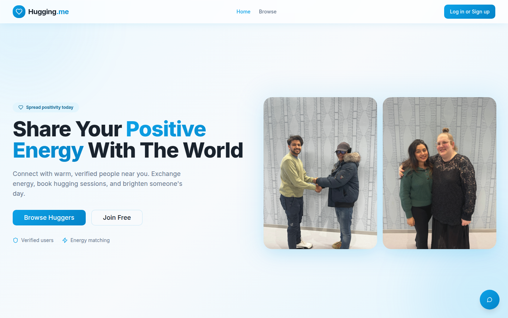
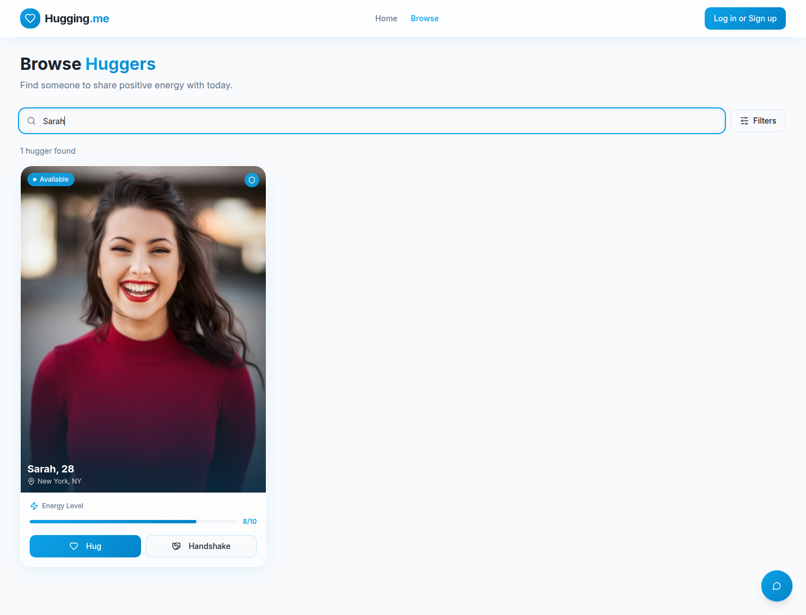
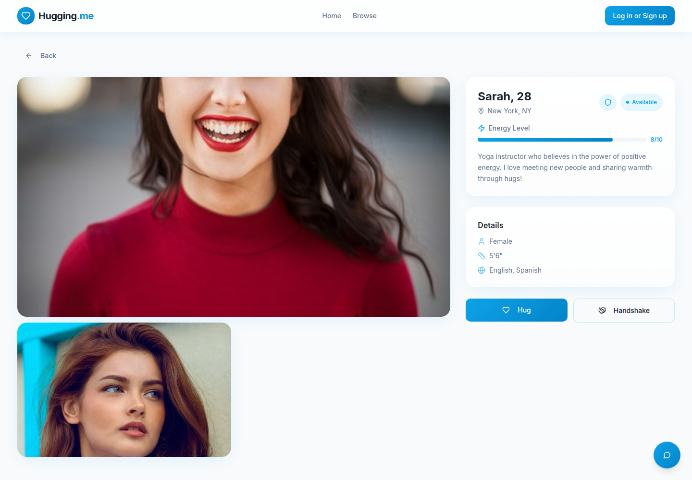
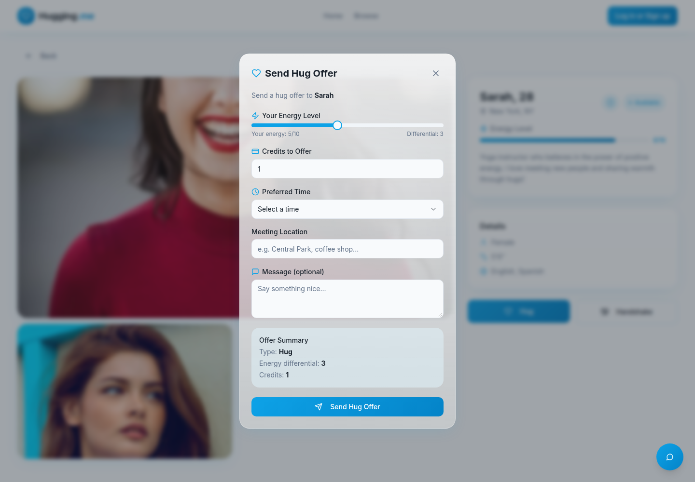
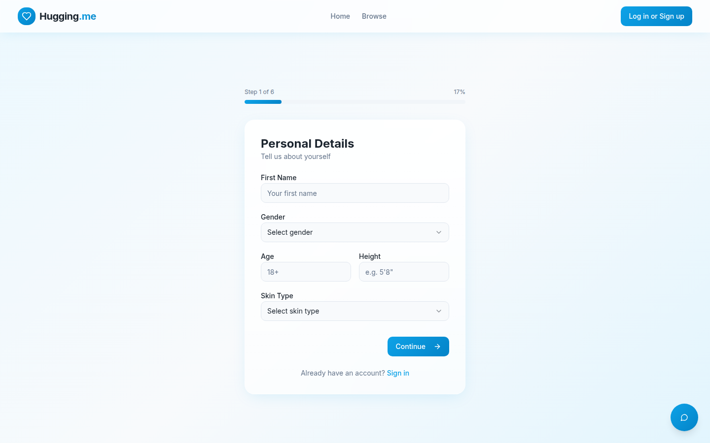
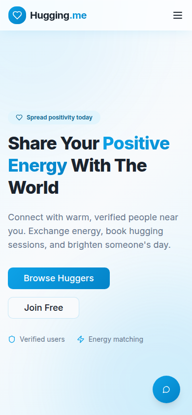

# Hugging.me

Hugging.me is a hackathon portfolio project by [Shay Bouchles](https://github.com/shaythegay13). It is a web app for finding someone to share a hug or a handshake with. People create a profile, set an energy level from 1 to 10, browse public profiles, and send an offer. A floating assistant, Dr. Hug, can search those profiles in conversation.

The interface was built to look like a finished product. A few flows are still demo-only. Those limits are listed under [Known limits](#known-limits).

**Live app:** [huggingme.lovable.app](https://huggingme.lovable.app)

**Demo video:** [youtu.be/LiMduVmjD3o](https://youtu.be/LiMduVmjD3o)

## Hackathon context

This repository is the public portfolio copy of that hackathon build. GitHub created it on 14 February 2026. The first commit is a Lovable Vite + React + shadcn/ui template (`template: new_style_vite_react_shadcn_ts_testing_2026-01-08`); git dates that commit 1 January 2025. Every later commit is from 14 February 2026 and is authored by `gpt-engineer-app[bot]` (GitHub lists that bot as `lovable-dev[bot]`). The history does not name an event, a prize, or other human authors.

Shay Bouchles owns the repository. Shay does not appear as a commit author.

## What it does

These behaviors are what the current code does.

- **Landing page.** Explains the product and links to browse and registration.
- **Email auth.** Register is a six-step flow: personal details, password, up to four photos, a preview, a terms checkbox, then a “check your email” screen. Login uses email and password. A database trigger creates a profile row on signup and copies `first_name` from signup metadata. New profiles start with 10 credits and energy level 5.
- **Profiles.** Signed-in users can edit name, bio, gender, age, height, skin type, location, languages, energy (1–10), “available today,” public/private visibility, and photos. Photos go to the public `profile-photos` storage bucket, under a folder named with the user’s id.
- **Browse.** Loads public profiles from Supabase and mixes them with six sample profiles bundled in the client. Search matches name or location. Filters cover available today, verified only, and a minimum energy level. Sort is by name or energy.
- **Profile page.** Sample profiles render immediately. Any other id is loaded from `profiles`. The page shows photos, energy, availability, verification, and a short details list.
- **Offers.** Hug and Handshake open a modal for energy, credits, time of day, meeting place, and an optional message. The modal shows an energy differential. Sending it checks that someone is logged in, then shows a toast. It does not write an `offers` row.
- **Dashboard.** Signed-out visitors are asked to log in. Signed-in users see their credit balance, energy, and offers they sent or received. Pending offers they received can be accepted or rejected. “Earned” and “spent” are sums of accepted offer amounts. Accepting an offer does not change the stored credit balance.
- **Dr. Hug.** A chat button on every page posts the conversation to the `matchmaker-chat` edge function and renders the streamed reply as Markdown. The function can call a `search_profiles` tool (availability, energy range, location, verified, gender) and then answer. That function runs only where it is deployed, with a Lovable API key that is not in this repo.
- **Verification.** `is_verified` is a boolean on the profile, default false. Browse can filter on it. There is no verification flow in the app.

Sample profiles live in `src/data/mockProfiles.ts`. They are fictional and use stock photos.

## Screenshots

Taken from a local `npm run dev` on port 8080. Browse is filtered to the bundled sample profile “Sarah” so the shot does not include live accounts.

| Home | Browse |
| --- | --- |
|  |  |

| Profile | Hug offer |
| --- | --- |
|  |  |

| Registration | Phone |
| --- | --- |
|  |  |

## Stack

| Piece | Used for |
| --- | --- |
| React 18, TypeScript | UI |
| Vite 5 | Dev server and production build |
| React Router 6 | Routes |
| TanStack Query | Profile and offer reads |
| React context | Auth session |
| Tailwind CSS, shadcn/ui, Radix | Layout and controls |
| Framer Motion | Page and card motion |
| Supabase | Postgres, Auth, Storage, and the Dr. Hug edge function |
| Lovable AI gateway | Dr. Hug model calls (`google/gemini-3-flash-preview`) |

Zustand, Zod, and React Hook Form are installed. The shadcn form primitive uses React Hook Form. The product screens keep form state in React `useState` and do not call Zod.

## Architecture

```text
Browser (Vite React SPA)
  ├─ supabase-js ── Auth (email/password, localStorage session)
  ├─ supabase-js ── Postgres via Row Level Security
  │    profiles, offers, schedule_settings
  ├─ supabase-js ── Storage bucket profile-photos
  └─ fetch ── Edge function matchmaker-chat
                ├─ Lovable AI gateway (LOVABLE_API_KEY, server only)
                └─ profiles query with the service role key (server only)
```

Routes in `src/App.tsx`:

| Path | Page |
| --- | --- |
| `/` | Landing |
| `/browse` | Browse |
| `/profile/:id` | Profile |
| `/register` | Registration |
| `/login` | Login |
| `/dashboard` | Credits and offers |
| `/edit-profile` | Edit profile |
| anything else | 404 |

`schedule_settings` exists in the migration, with owner-only RLS, and is not used by the UI.

### Access rules

From `supabase/migrations`:

- Profiles: a person can read and write their own row. Anyone can read rows with `is_public = true`.
- Offers: sender and receiver can read. The sender can insert. Sender or receiver can update. Either can delete.
- Schedule settings: owner only.
- Photos: a signed-in user can upload, update, and delete objects in their own folder. Anyone can read the bucket.

The browser uses the public anon key (`VITE_SUPABASE_PUBLISHABLE_KEY`). The service role key is read only inside the edge function from `SUPABASE_SERVICE_ROLE_KEY`.

## Setup

Requirements: Node.js 18 or newer (verified here with Node 22) and npm. This repo was installed with `npm ci`.

```sh
git clone https://github.com/shaythegay13/huggingme.git
cd huggingme
cp .env.example .env
npm ci
npm run dev
```

The dev server listens on port **8080** (`http://localhost:8080`).

`.env.example` lists names only. Fill them from the Supabase project settings (Project Settings → API):

| Name | What to put |
| --- | --- |
| `VITE_SUPABASE_URL` | Project URL |
| `VITE_SUPABASE_PUBLISHABLE_KEY` | The public anon key |
| `VITE_SUPABASE_PROJECT_ID` | Project ref |

Do not put the service role key in any `VITE_` variable. Vite exposes those to the browser.

Dr. Hug also needs the deployed function and these server secrets, which are not in the repo: `SUPABASE_URL`, `SUPABASE_SERVICE_ROLE_KEY`, `SUPABASE_PUBLISHABLE_KEY`, and `LOVABLE_API_KEY`.

Apply the SQL in `supabase/migrations` to a Supabase project before auth, profiles, photos, or offers will work. `supabase/config.toml` records the project ref used by the original Lovable project.

### Scripts

| Command | Result |
| --- | --- |
| `npm run dev` | Vite on port 8080 |
| `npm run build` | Production build in `dist/` |
| `npm run preview` | Serve that build |
| `npm test` | Vitest once |
| `npm run lint` | ESLint |

## Known limits

- The offer modal does not insert into `offers`, and it does not notify anyone. The dashboard can accept or reject offers that already exist.
- Accepting an offer does not move credits. The balance stays at the value stored on the profile (10 for a new account).
- Browse always includes the six sample profiles, then live public profiles. Sample cards open sample profile pages. Live cards open the database profile.
- There is no verification workflow, no distance filter (`max_distance` is stored and unused), and no schedule UI.
- Footer Privacy, Terms, and Contact links point at `#`.
- `npm run lint` still reports `no-explicit-any` in `supabase/functions/matchmaker-chat/index.ts`, plus fast-refresh warnings in shadcn files. `npm run build` and `npm test` succeed.
- `npm audit` reports vulnerabilities in the dependency tree. They were left in place so versions stay on the lockfile that builds.
- `.env` used to be committed. It contained only a public Supabase anon key, the project URL, and the project ref. It is no longer tracked. Those values remain in older commits because this change does not rewrite history.

## Contributors

From `git shortlog`:

| Author | Commits | Role |
| --- | --- | --- |
| [Lovable](mailto:noreply@lovable.dev) | 1 | Initial Vite, React, and shadcn/ui template |
| gpt-engineer-app[bot] | 39 | Product implementation in Lovable |

GitHub’s contributor list shows those bot commits as `lovable-dev[bot]`.

Project owner: [Shay Bouchles](https://github.com/shaythegay13).

## License

Proprietary. All rights reserved © 2026 Hugging.me.
